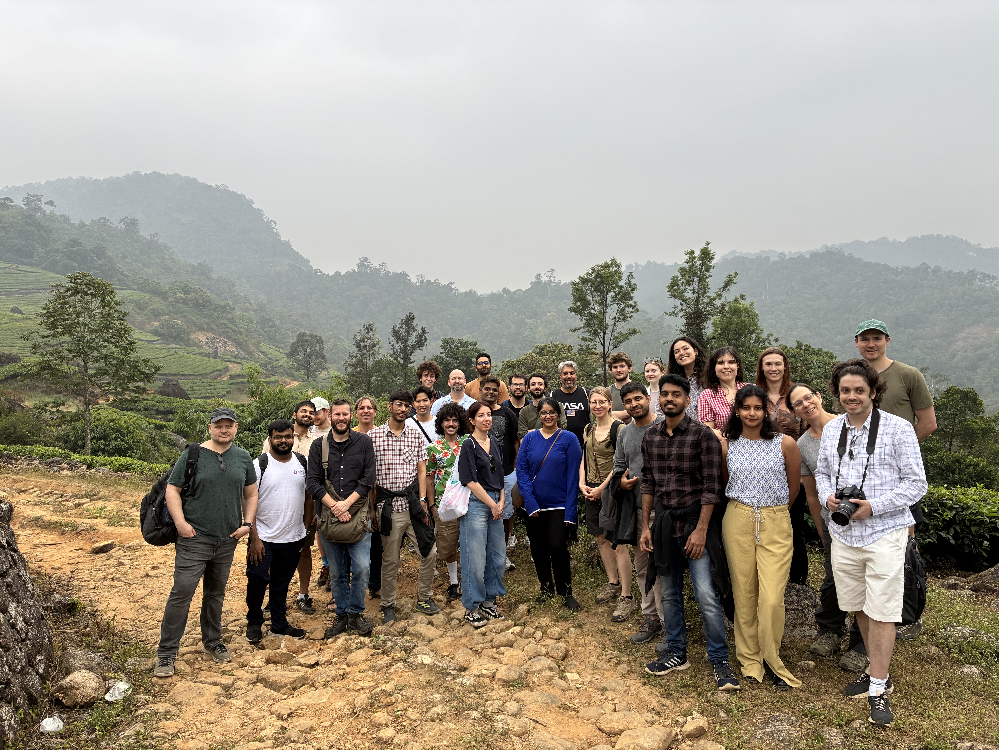
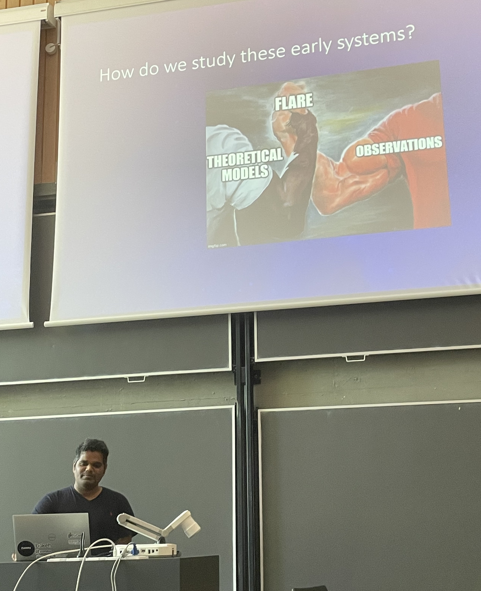
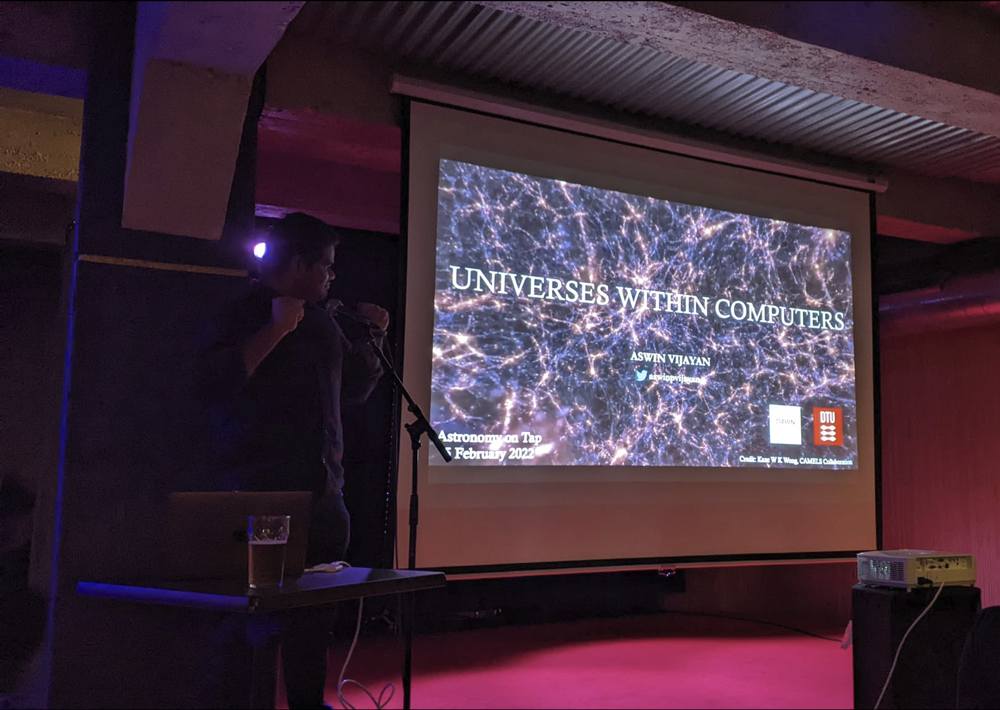
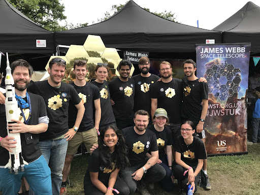

Below you will find some of the conferences and outreach events that I have been a part of.

<figure class="figure wide">

<figcaption>Group picture from an astronomy conference/workshop that I organised in Kerala, India in January 2026. I brought together a small group of astronomers working in the high-redshift Universe interested in synthetic observations and using them to understand galaxy formation and evolution. You can see a beautiful tea garden in Munnar in the background.</figcaption>
</figure>

<figure class="figure wide">

<figcaption>Review talk at <a href="https://cosmicdawn.dk/meetings-and-workshops/dawn-summit-2023/">Dawn Summit 2023</a> on first stars and galaxies.</figcaption>
</figure>

<figure class="figure wide">

<figcaption>Speaking to the public at Astronomy on Tap, Copenhagen on building Universes within computers.</figcaption>
</figure>

<figure class="figure wide">

<figcaption>At the JWST stand at Bluedot 2019 festival.</figcaption>
</figure>
