I am interested in working at the interface of theoretical modelling and observations, seeking to refine our understanding through an apples-to-apples comparison by forward modelling simulations.

My current focus is on modelling the spectral energy distributions (SEDs) of the broad and narrow line regions of active galactic nuclei (AGN) in Synthesizer, and on forward modelling publicly available, state-of-the-art cosmological simulations.

Below you will find some of the research that I have been involved with. If you are interested, feel free to [get in touch](../contact).

Synthesizer

<a href="https://synthesizer-project.github.io/">Synthesizer</a> is an open-source Python package for forward modelling synthetic astronomical observables, of which I am one of the co-PIs. It is designed to be fast, modular and flexible, allowing the user to generate spectra, photometry, images and spectral data cubes from both parametric models of galaxies and the outputs of cosmological hydrodynamical simulations and semi-analytic models. Synthesizer works with pre-computed grids of stellar population synthesis and AGN models, which can be post-processed with photoionisation codes such as Cloudy to include nebular line and continuum emission, and combined with models for dust attenuation and emission. This makes it easy to explore how different modelling choices change predicted observables, enabling like-for-like comparisons between theory and observations. The code is available on <a href="https://github.com/synthesizer-project/synthesizer">GitHub</a>, and the introductory paper can be found at <a href="https://ui.adsabs.harvard.edu/abs/2025arXiv250803888L/abstract">Lovell, Roper, Vijayan, Wilkins et al. (2025)</a> and the JOSS paper at <a href="https://joss.theoj.org/papers/10.21105/joss.09436">Roper, Lovell, Vijayan, Wilkins et al. (2026)</a>, with the stellar photoionisation modelling described in <a href="https://ui.adsabs.harvard.edu/abs/2026arXiv260727467V/abstract">Vijayan et al. (2026)</a>.

In <a href="https://ui.adsabs.harvard.edu/abs/2026arXiv260727467V/abstract">Vijayan et al. (2026)</a> we describe how emission from photoionised gas is incorporated into Synthesizer, and quantify how modelling choices such as the stellar population synthesis model, initial mass function, ionisation parameter, gas density, geometry, elemental abundances, depletion onto dust grains and dust itself affect commonly used spectral diagnostics. We also demonstrate how these models can be applied to everything from simple toy models to large cosmological simulations.

<figure class="figure">
<a href="/images/synthesizer_parametric.png">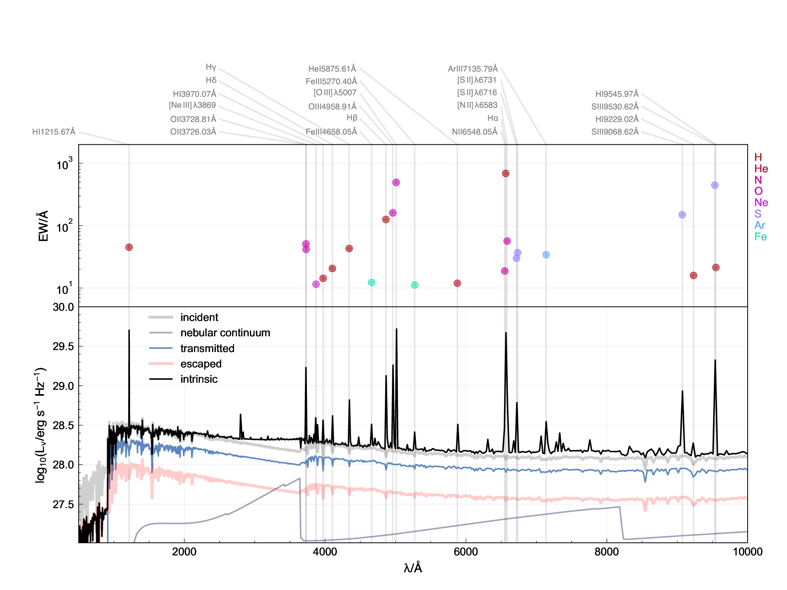</a>
<figcaption>Spectra of a parametric stellar population generated with Synthesizer. The bottom panel shows the different spectral components (incident, nebular continuum, transmitted, escaped and intrinsic), while the top panel shows the equivalent widths of prominent emission lines, coloured by element. From <a href="https://ui.adsabs.harvard.edu/abs/2026arXiv260727467V/abstract">Vijayan et al. (2026)</a>.</figcaption>
</figure>

Dust in the Colibre simulations

Colibre is a new suite of cosmological hydrodynamical simulations of galaxy formation that models the cold interstellar medium and follows the formation and evolution of dust grains during the simulation (<a href="https://academic.oup.com/mnras/article/548/1/stag375/8650959">Schaye et al. 2026</a>; <a href="https://academic.oup.com/mnras/article/548/1/stag300/8650960">Chaikin et al. 2026</a>). In <a href="https://ui.adsabs.harvard.edu/abs/2026arXiv260726058V/abstract">Vijayan et al. (2026)</a> we study how galaxy dust scaling relations evolve over 0 &le; z &le; 15, using volumes of up to (400 cMpc)3 at three different mass resolutions. We present predictions for the dust mass function, the cosmic dust mass density and dust scaling relations such as the dust-to-metal and dust-to-gas ratios.

We find that silicates dominate the dust mass at all epochs. The model broadly reproduces most observed dust scaling relations across cosmic time, although it overpredicts the cosmic dust mass density at z &lt; 1 and underpredicts the number of bright submillimetre galaxies at z &ge; 2. The scaling relations are only sensitive to numerical resolution for low-mass galaxies at low redshift.

<figure class="figure">
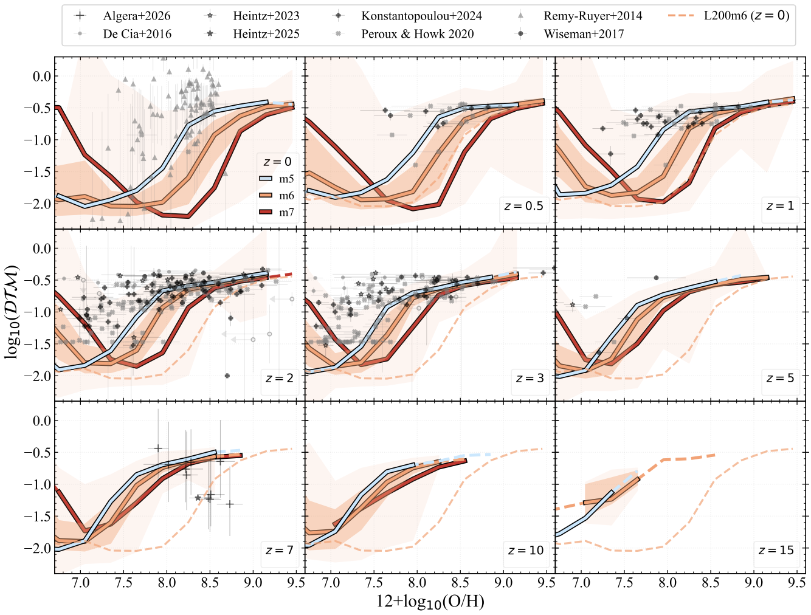
<figcaption>The dust-to-metal ratio as a function of gas-phase metallicity in Colibre from z = 0 to 15, for three different resolutions (m5, m6 and m7). The dashed line shows the z = 0 relation from the L200m6 volume for reference. Also shown are observational constraints at these redshifts.</figcaption>
</figure>

Interpreting nebular emission lines at high redshift

JWST now routinely measures nebular emission lines from galaxies in the first billion years, and these are used to infer quantities such as the star formation rate, the ionising photon production efficiency and the gas-phase oxygen abundance. In <a href="https://ui.adsabs.harvard.edu/abs/2025arXiv250720190V/abstract">Vijayan et al. (2025)</a> we test how reliable these diagnostics are at z &ge; 5, focusing on dust corrections based on the V-band attenuation (AV) and the Balmer decrement. Using both toy models and galaxies from Flares, we show that the clumpy structure of galaxies biases the inferred properties, and that no single dust-correction method gives unbiased results for all of these quantities.

First Light And Reionisation Epoch Simulations (Flares)

<a href="https://flaresimulations.github.io/">Flares</a> is a suite of high-resolution hydrodynamic simulations of galaxy formation and evolution using the Eagle physics. The suite consists of 40 zoom resimulations of spherical regions selected at z=5 from a 3.2 cGpc a side, parent dark matter-only box. We select a range of overdensities in order to study the environmental effect on high-redshift galaxy evolution. We also combine these resimulations in order to produce composite distribution functions, significantly extending the dynamic range of the model over smaller volume, periodic simulations. The introductory papers can be found at <a href="https://ui.adsabs.harvard.edu/abs/2021MNRAS.500.2127L/abstract">Lovell et al. (2021)</a> and <a href="https://ui.adsabs.harvard.edu/abs/2021MNRAS.501.3289V/abstract">Vijayan et al. (2021)</a>.  

<figure class="figure">
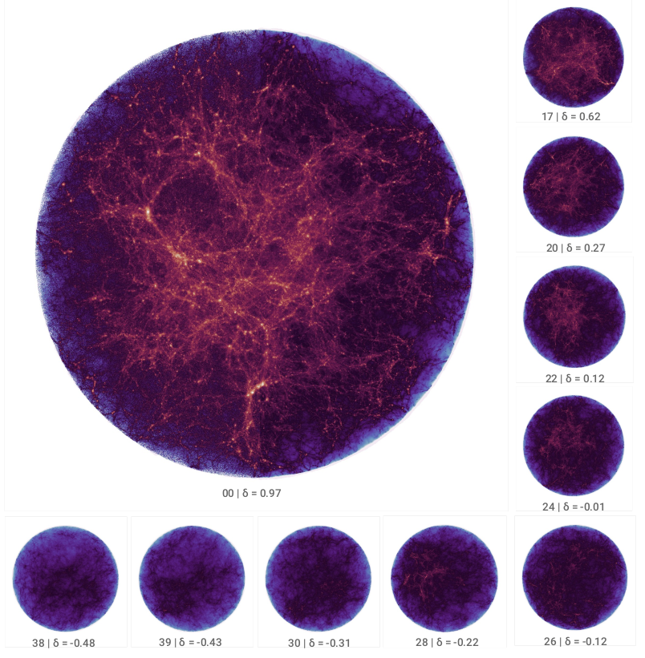
<figcaption>DM visualisation of a few selected regions in Flares.</figcaption>
</figure>

<figure class="figure">
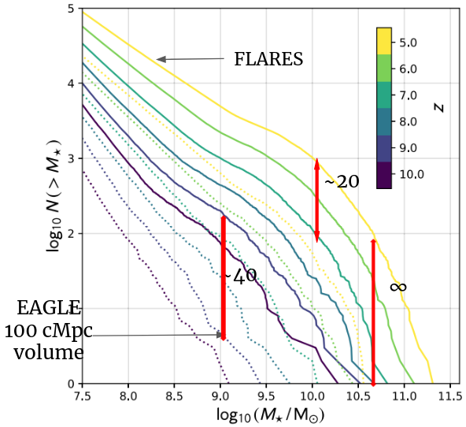
<figcaption>Combined cumulative galaxy number counts of Flares compared to the Eagle Reference simulation volume. Flares has ~20 times more galaxies with stellar mass greater than 1010 M&odot;.</figcaption>
</figure>

The increased dynamic range probed by Flares allows us to make predictions for a number of large area surveys that will probe the EoR in coming years, such as Euclid and Nancy Grace Roman Space Telescope as well as JWST.  As can be seen from the cumulative galaxy mass function plot above, the mass range has been significantly extended compared to the Eagle reference volume. Also Flares has access to a much larger sample of galaxies, thus providing a useful statistical sample of galaxies accessible to upcoming facilities.

<figure class="figure">
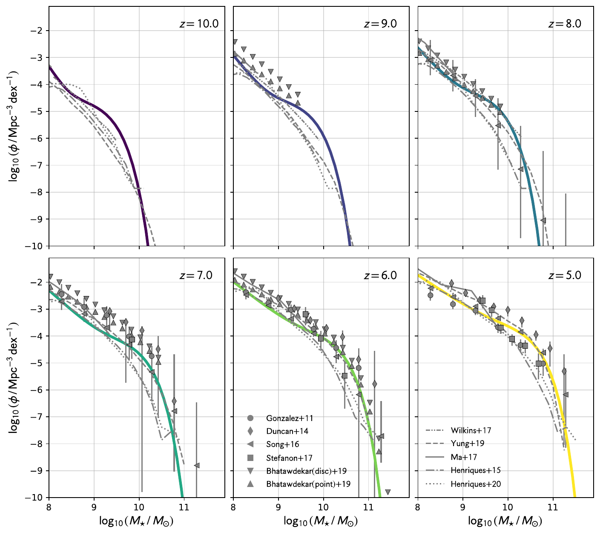
<figcaption>Stellar mass function of the Flares galaxies in z=5-10, observations and model values are plotted alongside.</figcaption>
</figure>

<figure class="figure">
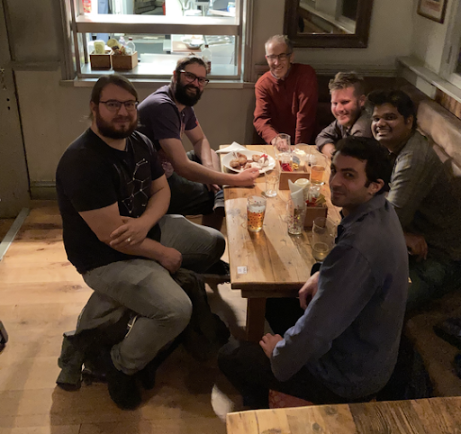
<figcaption>A past Flares team meeting in Brighton.</figcaption>
</figure>

Flares Line-of-sight dust modelling

We use a line-of-sight (LOS) dust extinction model to model the photometric properties of the galaxies in the simulation. This is done by assuming that the dust optical depth along the line of sight is proportional to the LOS dust column density. We convert the LOS metal density for each star particle to a dust density based on the dust-to-metal ratio fitting function presented in <a href="https://ui.adsabs.harvard.edu/abs/2019MNRAS.489.4072V/abstract">Vijayan et al. (2019)</a>. We calibrate the proportionality constant based on the luminosity function at z=5 presented in <a href="https://ui.adsabs.harvard.edu/abs/2015ApJ...803...34B/abstract">Bouwens et al. (2015)</a> as well as the UV-continuum slope from <a href="https://ui.adsabs.harvard.edu/abs/2014ApJ...793..115B/abstract">Bouwens et al. (2014)</a> at z=5 and the [OIII] doublet EW measurements at z=8 from <a href="https://ui.adsabs.harvard.edu/abs/2019MNRAS.489.2355D/abstract">De Barros et al. (2019)</a>.

<figure class="figure">
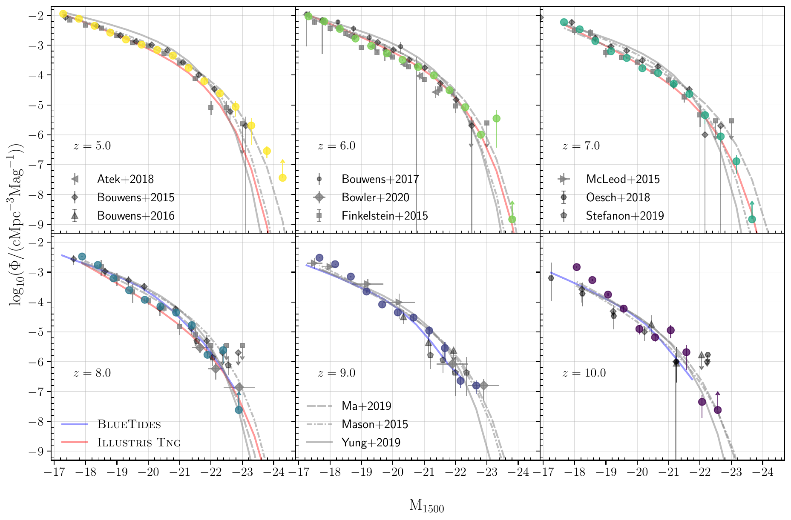
<figcaption>UV luminosity function of the Flares galaxies in the range z=5-10. Also shown are data points from observations and models. The Flares galaxies extend the UV luminosity function to brighter luminosities.</figcaption>
</figure>

<figure class="figure narrow">
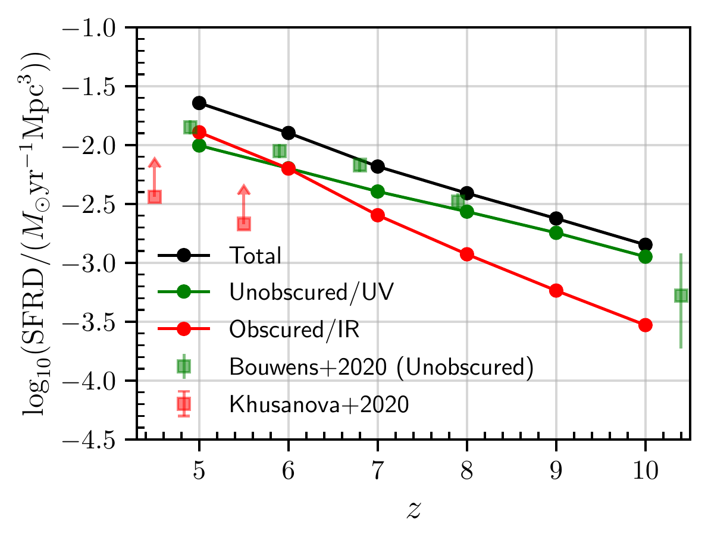
<figcaption>The star formation rate density evolution as probed by Flares.</figcaption>
</figure>

We find no environmental dependence on the shape of the UV luminosity function. Another interesting observation is that the obscured star formation rate density (SFRD) is almost equal to the unobscured SFRD by z~6 and starts to dominate at lower redshifts.

Flares-skirt modelling

We modelled the full SED of the galaxy in post-processing using the radiative transfer code <a href="https://skirt.ugent.be/">skirt</a> in <a href="https://ui.adsabs.harvard.edu/abs/2022MNRAS.511.4999V/abstract">Vijayan et al. (2022)</a>. The modelling assumptions build upon previous Eagle-skirt work done in <a href="https://ui.adsabs.harvard.edu/abs/2016MNRAS.462.1057C/abstract">Camps et al. (2016)</a> and <a href="https://ui.adsabs.harvard.edu/abs/2017MNRAS.470..771T/abstract">Trayford et al. (2017)</a>. We look at the infrared luminosity function, the infrared excess (IRX) and the light-weighted dust temperatures of the most massive galaxies in Flares in the redshift range 5-10.

We find that the IR LF is underpredicted at bright IR luminosities compared to current observational results. We see that the Flares IRX-&beta; relation mainly follows the local starburst relation. We also see an evolution of the light-weighted dust temperatures towards higher values with increasing redshift.

<figure class="figure">
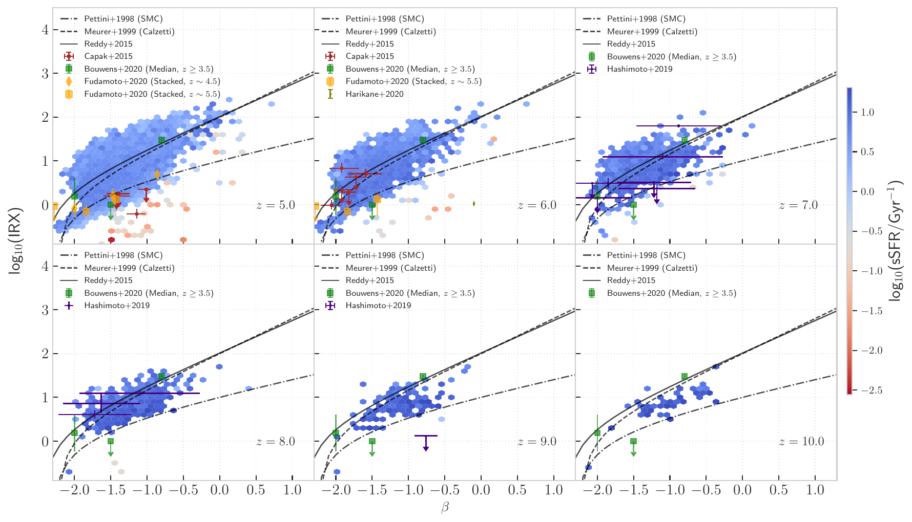
<figcaption>The IRX-&beta; relation of Flares galaxies at z=5-10 coloured by their specific star formation rate. Also shown are some observational and theoretical data at these redshifts.</figcaption>
</figure>

<figure class="figure narrow">
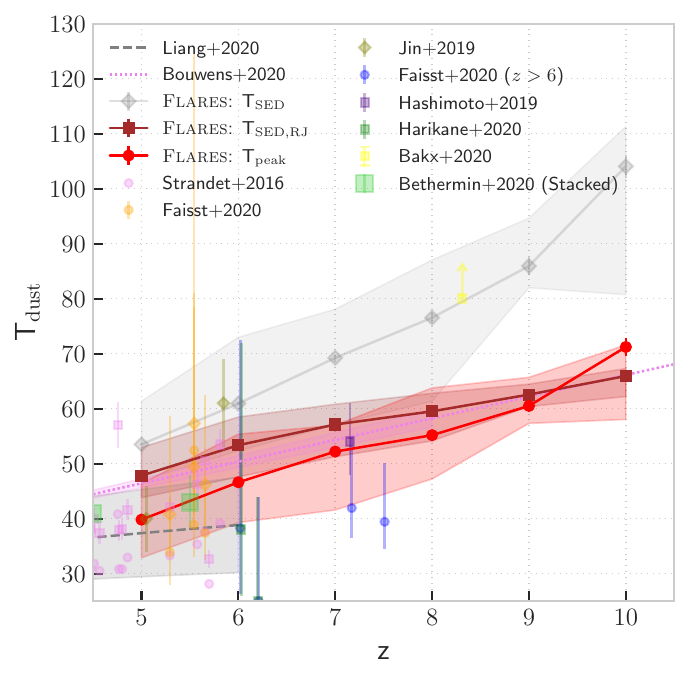
<figcaption>The redshift evolution of the light-weighted dust temperatures of the Flares galaxies at z=5-10. Tpeak is the temperature derived from the wavelength at which the IR flux density peaks, TSED is the dust temperature obtained from fitting a mid-IR power law + modified blackbody (MBB) to the IR SED, while TSED,RJ is the temperature from an optically-thin MBB. Also shown are some observational and theoretical data at these redshifts.</figcaption>
</figure>

Sizes of massive dusty galaxies from the UV to the IR

In <a href="https://ui.adsabs.harvard.edu/abs/2025A%26A...696A.234P/abstract">Punyasheel et al. (2025)</a>, led by my student Paurush Punyasheel, we study the UV and far-infrared sizes of massive (M&#8902; &gtrsim; 109 M&odot;) Flares galaxies at 5 &le; z &le; 10, using the skirt radiative transfer models and mock JWST NIRCam and ALMA observations. We find that dust makes galaxies appear smaller in the UV, that their far-infrared sizes do not evolve with redshift, and that noise and the instrumental PSF strongly affect the measured sizes. The predicted evolution of UV sizes broadly agrees with observations.

<figure class="figure">
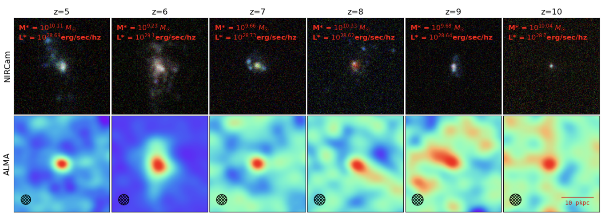
<figcaption>Mock JWST NIRCam (top) and ALMA (bottom) images of massive Flares galaxies from z = 5 to 10, labelled with their stellar masses and UV luminosities.</figcaption>
</figure>

Offsets between UV and dust emission

In <a href="https://ui.adsabs.harvard.edu/abs/2026arXiv260527370P/abstract">Punyasheel et al. (2026)</a>, also led by Paurush Punyasheel, we measure the spatial offsets between the UV and far-infrared emission of 6890 massive Flares galaxies at 5 &le; z &le; 10, using mock JWST NIRCam and ALMA observations. About 16% of galaxies show offsets of at least 2.5 kpc. These offsets do not correlate with stellar mass, luminosity, size, AGN feedback, environment or merger history, but the offset galaxies have bluer UV slopes and formed their stars earlier.

Dust Modelling in L-Galaxies Semi-Analytical Model

L-Galaxies is a semi-analytical model (SAM), implemented on the Millennium (<a href="https://ui.adsabs.harvard.edu/abs/2005Natur.435..629S/abstract">Springel et al. 2005</a>) and Millennium-II (<a href="https://ui.adsabs.harvard.edu/abs/2009MNRAS.398.1150B/abstract">Boylan-Kolchin et al. 2009</a>) simulation merger trees. The model has been developed over the years to include the relevant processes required for galaxy evolution. The model has been successful in matching many of the observational results like the galaxy stellar mass function across redshifts (Henriques et al. <a href="https://ui.adsabs.harvard.edu/abs/2015MNRAS.451.2663H/abstract">2015</a>, <a href="https://ui.adsabs.harvard.edu/abs/2020MNRAS.491.5795H/abstract">2020</a>), the high redshift ( z ≥ 4 ) UV luminosity function (<a href="https://ui.adsabs.harvard.edu/abs/2015MNRAS.451.2692C/abstract">Clay et al., 2015</a>). A self-consistent model of dust formation and evolution has been incorporated in the L-Galaxies' SAM, which is built on top of the <a href="https://ui.adsabs.harvard.edu/abs/2015MNRAS.451.2663H/abstract">Henriques et al. (2015)</a> model.

<figure class="figure">
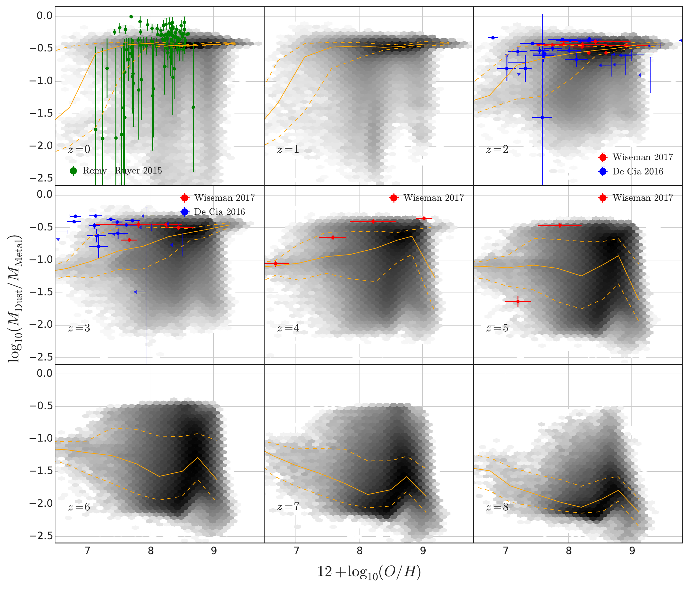
<figcaption>The dust-to-metal ratio as a function of their metallicity from z = 0-8. The orange line shows the median result from galaxies in our model, with the dashed lines denoting the 84 and 16 percentiles. Green, blue and red points show the observational constraints from Rémy-Ruyer et al. (2015), De Cia et al. (2016) and Wiseman et al. (2017) respectively.</figcaption>
</figure>

<figure class="figure">
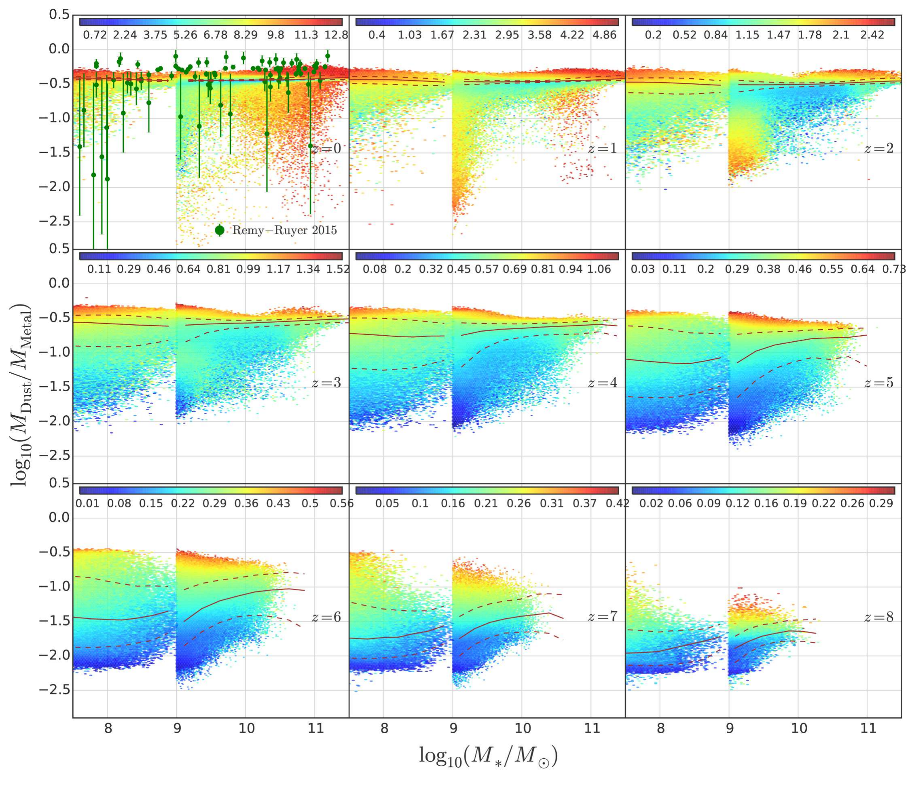
<figcaption>The dust-to-metal ratio as a function of stellar mass from z = 0 − 8, with galaxies coloured according to their mass-weighted stellar age in Gyr. Green points show the observational constraints from Rémy-Ruyer et al. (2015).</figcaption>
</figure>

The novel features in this work, compared to similar efforts that have been published for semi-analytic and hydrodynamic models (e.g. <a href="https://ui.adsabs.harvard.edu/abs/2017MNRAS.471.3152P/abstract">Popping et al., 2017</a>; <a href="https://ui.adsabs.harvard.edu/abs/2017MNRAS.468.1505M/abstract">McKinnon et al., 2017</a>), are (i) the more accurate consideration of the impact of molecular cloud chemistry on grain growth in dense molecular clouds (by separate tracking of dust in molecular and diffuse gas) and (ii) incorporating information on the critical metals in the main dust species as well as dust depletion fractions. The former results in the diverse distribution of the dust-to-metal ratio seen in the high-redshift Universe in the model and the latter to the non-saturation of metal depletion onto dust. The model also predicts grain growth to be the dominant dust production mechanism for z ≤ 8. We see an evolution across redshifts in the dust-to-metal (DTM) ratio from low to high values, the former corresponding to dust injection from type II supernovae, and the other to maximal, saturated dust production occurring via dust growth on grains. The latter dominates at redshifts below z~4. We also see a significantly populated transition region at z = 6. We also provide a fitting function for the DTM ratio from our model, as a function of the gas-phase metallicity and the age of the galaxy stellar population, which provides a useful tool for simulators and observers alike.

The DTM fitting function is expressed as below:

DTMfit = D0  + (D1 -D0 )(1-exp(-&alpha;Z&beta;(Age/&tau;)&gamma;)),

where D0 and D1 represent the initial type-II SNe dust injection and the saturation value, respectively, Z is the metallicity of the interstellar medium, Age is the mass-weighted age of the stellar population, and &tau;=&tau;acc,0/(D0Z) is an estimate of the initial dust growth timescale after dust injection from type-II supernovae but prior to the initiation of dust growth on grains. We fix the values of D0 and D1 by reference to the figure showing the relationship between the DTM ratio and stellar mass. The parameter values are as follows: D0 = 0.008, D1 = 0.329, &alpha; = 0.017, &beta; = -1.337 and &gamma; = 2.122.

